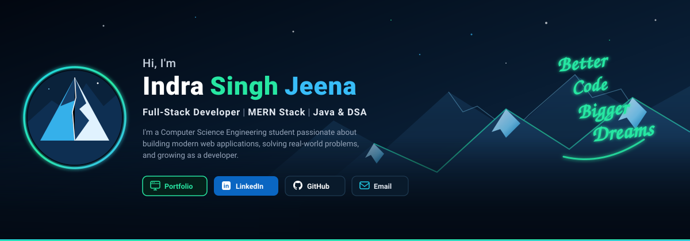
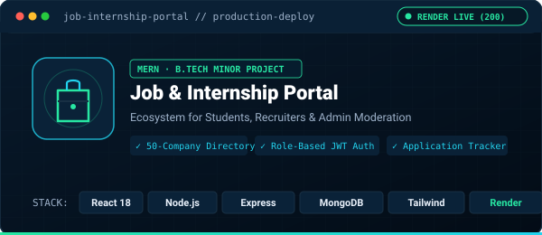
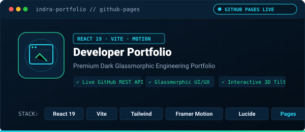
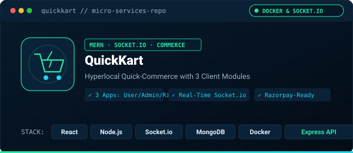
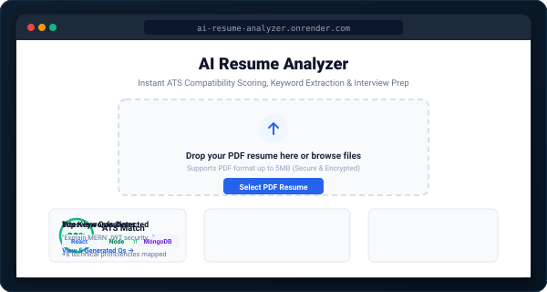

<!-- Top Navigation & Social Strip -->

  

<!-- Hero Cinematic Mountain Banner -->

 

  <strong>Build. Learn. Improve. Repeat.</strong>

---

### `01` — Core Information

<table>
  <tr>
    <td width="33%" valign="top">
      <h3>⚡ About Me</h3>
      
I am a <strong>Computer Science Engineering student</strong> passionate about building practical, production-minded web applications and sharpening my engineering fundamentals.

      <ul>
        <li>Developing full-stack web applications using the <strong>MERN stack</strong>.</li>
        <li>Practising Data Structures &amp; Algorithms in <strong>Java</strong>.</li>
        <li>Exploring <strong>Python</strong> and backend services.</li>
        <li>Interested in internships, entry-level opportunities, and tech collaboration.</li>
      </ul>
      
<em>“Turning ideas into applications. Turning learning into progress.”</em>

    </td>
    <td width="34%" valign="top">
      <h3>🛠️ Tech Stack</h3>
      
<strong>Languages</strong>

      
      
<strong>Frontend &amp; Backend</strong>

      
      
<strong>Databases</strong>

      
      
<strong>Tools &amp; DevOps</strong>

      
    </td>
    <td width="33%" valign="top">
      <h3>📌 Quick Facts</h3>
      
<strong>🎯 Target Role:</strong> Full-Stack / MERN Developer

      
<strong>💡 Technical Focus:</strong> MERN Stack · Java + DSA · Python

      
<strong>🎓 Education:</strong> B.Tech CSE (Pursuing)

      
<strong>📍 Location:</strong> India

      
<strong>🟢 Availability:</strong> Open to internships &amp; entry-level opportunities

    </td>
  </tr>
</table>

---

### `02` — Featured Projects

<table>
  <tr>
    <td width="50%" valign="top">
      
        
      <h4><a href="https://github.com/indrasingh29/job-internship-portal">Job &amp; Internship Portal</a></h4>
      
<code>React 18</code> <code>Node.js</code> <code>Express</code> <code>MongoDB</code> <code>Tailwind CSS</code> <code>Render</code>

      
A production-ready MERN platform connecting students, recruiters, and administrators with dedicated workflows and telemetry.

      <ul>
        <li><strong>Curated Directory:</strong> 50 tech employer profiles with 52 active job and internship listings.</li>
        <li><strong>Role-Based Access:</strong> Granular JWT auth guards for Student, Recruiter, and Admin portals.</li>
        <li><strong>Application Tracking:</strong> Track application statuses, cover letters, and bookmarked opportunities.</li>
      </ul>
      

        <a href="https://github.com/indrasingh29/job-internship-portal"><b>↗ GitHub Repository</b></a> &nbsp;|&nbsp;
        <a href="https://job-portal-web-8a3p.onrender.com"><b>🌐 Live Web App</b></a>
      

    </td>
    <td width="50%" valign="top">
      
        
      <h4><a href="https://github.com/indrasingh29/indra-portfolio">Developer Portfolio</a></h4>
      
<code>React 19</code> <code>Vite</code> <code>Tailwind CSS</code> <code>Framer Motion</code> <code>GitHub API</code> <code>Pages</code>

      
A modern, recruiter-focused developer portfolio featuring glassmorphic design and interactive animations.

      <ul>
        <li><strong>Dynamic REST API:</strong> Live GitHub profile &amp; repository statistics with local caching and offline fallback.</li>
        <li><strong>Modern UI/UX:</strong> Glassmorphic cards, canvas particle constellation, and interactive 3D perspective tilt effects.</li>
        <li><strong>Recruiter Utilities:</strong> Deep-dive architecture modal, ATS resume download, and automated GitHub Pages CI/CD.</li>
      </ul>
      

        <a href="https://github.com/indrasingh29/indra-portfolio"><b>↗ GitHub Repository</b></a> &nbsp;|&nbsp;
        <a href="https://indrasingh29.github.io/indra-portfolio/"><b>🌐 Live Website</b></a>
      

    </td>
  </tr>
  <tr>
    <td width="50%" valign="top">
      
        
      <h4><a href="https://github.com/indrasingh29/quickkart">QuickKart</a></h4>
      
<code>MERN Stack</code> <code>Socket.io</code> <code>Docker</code> <code>Razorpay-Ready</code> <code>Tailwind CSS</code>

      
A hyperlocal quick-commerce platform architected with three client applications and real-time order tracking.

      <ul>
        <li><strong>3 Client Apps:</strong> Customer storefront, admin operations dashboard, and rider delivery app.</li>
        <li><strong>Live Telemetry:</strong> Real-time order status updates and location broadcasts powered by Socket.io.</li>
        <li><strong>Robust Backend:</strong> Role-based access control, indexed MongoDB schemas, Razorpay-ready payment flow, and Docker orchestration.</li>
      </ul>
      

        <a href="https://github.com/indrasingh29/quickkart"><b>↗ GitHub Repository</b></a>
      

    </td>
    <td width="50%" valign="top">
      
        
      <h4><a href="https://github.com/indrasingh29/ai-resume-analyzer">AI Resume Analyzer</a></h4>
      
<code>Next.js</code> <code>Node.js</code> <code>Express</code> <code>MongoDB</code> <code>Tailwind CSS</code> <code>Docker</code>

      
An ATS resume evaluation platform providing automated feedback, scoring, and tailored interview questions.

      <ul>
        <li><strong>ATS Scoring Engine:</strong> Automated PDF resume text extraction with instant ATS compatibility scoring.</li>
        <li><strong>Gap Analysis:</strong> Detailed keyword gap breakdown, tailored strength highlights, and generated interview questions.</li>
        <li><strong>User Dashboard:</strong> Secure JWT authentication with persistent analysis history and Render Blueprint deployment.</li>
      </ul>
      

        <a href="https://github.com/indrasingh29/ai-resume-analyzer"><b>↗ GitHub Repository</b></a> &nbsp;|&nbsp;
        <a href="https://ai-resume-analyzer-web-usrb.onrender.com"><b>🌐 Live Web App</b></a>
      

    </td>
  </tr>
</table>

---

### `03` — GitHub Analytics

  

---

### `04` — Connect & Collaborate

| Platform | Handle / Direct Link | Purpose |
| :--- | :--- | :--- |
| 🌐 **Portfolio** | [indrasingh29.github.io/indra-portfolio](https://indrasingh29.github.io/indra-portfolio/) | Interactive showcase, projects & resume |
| 💼 **LinkedIn** | [linkedin.com/in/indra-singh-jeena-1a9542216](https://www.linkedin.com/in/indra-singh-jeena-1a9542216/) | Professional networking & opportunities |
| 💻 **GitHub** | [@indrasingh29](https://github.com/indrasingh29) | Code repositories & open-source projects |
| ✉️ **Email** | [indrasinghjeena@gmail.com](mailto:indrasinghjeena@gmail.com) | Direct inquiries & collaboration |

 

**BUILD WITH PURPOSE. LEARN EVERY DAY. KEEP IMPROVING.**

 

© 2026 Indra Singh Jeena · Crafted with dark navy &amp; neon mint aesthetics

